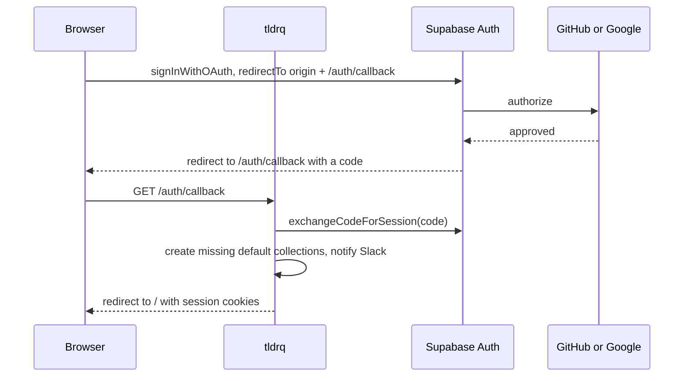
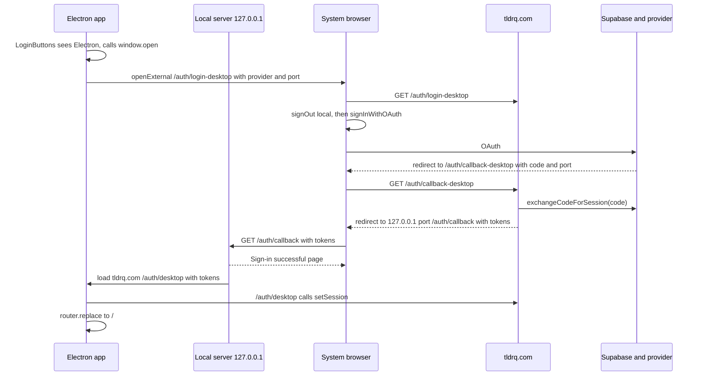

# Authentication

tldrq has no passwords: users sign in with GitHub or Google through Supabase Auth, and the session lives in cookies
that `@supabase/ssr` manages. The desktop app signs in through the system browser and hands the session back to
the app.

## Supabase clients

| File | Function | Used by |
|---|---|---|
| `src/lib/supabase/server.ts` | `createClient()` (async): `createServerClient` with `await cookies()` | Server components and route handlers |
| `src/lib/supabase/client.ts` | `createClient()`: `createBrowserClient` | The browser: starting OAuth, `setSession`, signing out |
| `src/lib/supabase/middleware.ts` | `updateSession(request)`: `createServerClient` over the request's cookies | The proxy |

The server client's `setAll` swallows errors: Server Components can't set cookies, and the proxy refreshes the
session anyway.

## The proxy

`src/proxy.ts` (the Next.js 16 name for middleware) runs `updateSession` on every request except `_next/static`,
`_next/image`, `favicon.ico` and image files (`svg`, `png`, `jpg`, `jpeg`, `gif`, `webp`).

`updateSession` calls `supabase.auth.getUser()`, which refreshes the session and writes the refreshed cookies to
the response. If there's no user, any path other than `/login`, `/auth/*` and `/share/*` is redirected to `/login`.
That includes `/api/*`: a signed-out API call gets the redirect before its handler's own 401 check runs.

`src/app/(main)/layout.tsx` checks `getUser()` again before rendering the dashboard.

## Web sign-in



1. `LoginButtons` (`src/components/auth/login-buttons.tsx`) calls
   `signInWithOAuth({ provider, options: { redirectTo: origin + "/auth/callback" } })`.
2. Supabase sends the user to GitHub or Google and back, then to `/auth/callback?code=…`.
3. `src/app/auth/callback/route.ts` calls `exchangeCodeForSession(code)`, which sets the session cookies, creates
   any missing [default collections](#default-collections-and-notifications), sends the Slack notice, and redirects
   to the `next` query parameter if there is one (nothing in the app sets it), else `/`.
4. With no code, or a failed exchange, it redirects to `/login?error=auth`. `LoginButtons` then shows the
   `error_description` from the URL's hash if Supabase put one there, else "Authentication failed. Please try
   again."

## Default collections and notifications

Both callbacks, `/auth/callback` and `/auth/callback-desktop`, select the user's collections named Videos, Tweets,
Articles and Repos, insert the ones that are missing, and call `notifySlackUserLogin` (see
[Slack sign-in notifications](configuration.md#slack-sign-in-notifications)). The two route handlers duplicate this
code, so change both together.

## Desktop sign-in

Electron's window doesn't handle the providers' passkey and PKCE flows well, so the desktop app signs in through
the system browser and gets the tokens back over a loopback HTTP server.



1. In the app, `LoginButtons` sees `Electron` in the user agent and, instead of starting OAuth, calls
   `window.open(origin + "/auth/login-desktop?provider=…")`.
2. `setWindowOpenHandler` in `electron/main.js` appends `&port=` and the local server's port, and opens the URL in
   the default browser with `shell.openExternal`.
3. In the browser, `src/app/auth/login-desktop/page.tsx` calls `signOut({ scope: "local" })` to clear any stale
   session or PKCE state, then `signInWithOAuth` with `redirectTo: origin + "/auth/callback-desktop?port=…"`.
4. After the provider, `src/app/auth/callback-desktop/route.ts` exchanges the code (in the browser's request),
   creates missing default collections, sends the Slack notice, and redirects to
   `http://127.0.0.1:<port>/auth/callback?access_token=…&refresh_token=…`.
5. The app's local server, listening on `127.0.0.1` at a random port since the app started, answers with a page
   reading "Sign-in successful! You can close this tab." and loads
   `https://tldrq.com/auth/desktop?access_token=…&refresh_token=…` in the main window.
6. `src/app/auth/desktop/page.tsx` sees the Electron user agent, calls `supabase.auth.setSession` with the two
   tokens, and `router.replace("/")`.

The tokens travel in URL query strings: the system browser's redirect to the loopback address leaves them in its
history, and the app's request for `/auth/desktop` sends them to tldrq.com in the URL.

Step 4 exchanges the code in the system browser's request, so it also stores the session in that browser's cookies,
and the app then uses the same tokens. The app and that browser therefore share one session: a local-scope sign-out
in either one ends it for both. Step 3's sign-out also ends whatever session the browser had before.

### Fallbacks

- `will-navigate` in `electron/main.js` cancels any navigation to a `supabase.co/auth` URL inside the app. When the
  URL has a `provider` parameter, it reopens it as `/auth/login-desktop?provider=…&port=…` in the system browser.
- `/auth/callback-desktop` without a `port` just redirects to `/`.
- `/auth/desktop` opened outside Electron tries a `tldrq://auth/callback?…` link and, after 1.5 seconds, shows
  "Sign-in successful! You can close this tab and return to the tldrq app." The app doesn't register a `tldrq://`
  handler (`electron/main.js` has none), so the loopback server is the path that actually completes sign-in.

## Signing out

`SignOutButton` (`src/components/layout/sign-out-button.tsx`) calls `signOut({ scope: "local" })` and
`router.push("/login")`. The local scope ends only the current session; Supabase's default, global scope would end
every session the user has, on every device. `/auth/login-desktop` uses the local scope for the same reason.

## Supabase redirect URLs

Sign-in returns to whatever origin it started from, so Supabase's redirect URL list needs, for every origin users
sign in from, `<origin>/auth/callback`, plus `<origin>/auth/callback-desktop` where the desktop app is used. For
example:

```text
https://tldrq.com/auth/callback
https://tldrq.com/auth/callback-desktop
http://localhost:3000/auth/callback
```

[Deployment](deployment.md#3-url-configuration) covers the rest of the Supabase setup.
