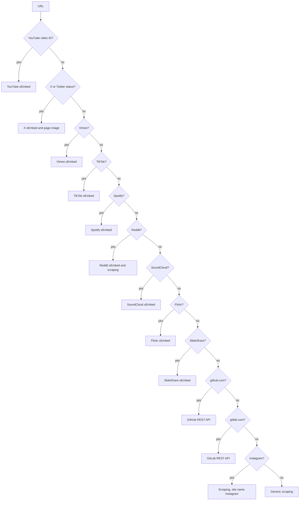

# Metadata Fetching

When a bookmark is saved, tldrq fetches its title, description, thumbnail and, for repositories, stats.
Everything lives in `src/lib/utils/metadata.ts`, with image URL handling in `src/lib/utils/ui.ts`.

## Where it runs

`fetchOGMetadata(url)` runs on the server, once per bookmark:

- from `POST /api/bookmarks`, before the insert;
- from `GET /api/metadata?url=…`, which nothing in the UI calls but which is handy for trying the fetcher on a URL
  (see the [API Reference](api.md#metadata)).

Metadata is never fetched again for a saved bookmark.

## The result

```ts
export interface OGMetadata {
  title: string | null;
  description: string | null;
  image_url: string | null;
  site_name: string | null;
  repo_stars?: number | null;
  repo_forks?: number | null;
  repo_language?: string | null;
}
```

The fields are stored on the bookmark row as they are (see [Database](database.md#bookmarks)).

## Dispatch

`fetchOGMetadata` tries the platform detectors in order and uses the first that matches:



## Platform handlers

Most oEmbed handlers use `fetchOEmbedMetadata(oembedUrl, siteName)`, the *standard mapping*: `title` from the
oEmbed `title`, `description` as `By` plus `author_name`, `image_url` from `thumbnail_url`, and a fixed `site_name`.

| Platform | Detected by | Source | Mapping |
|---|---|---|---|
| YouTube | Host `youtu.be`, or `youtube.com`, `www.youtube.com` or `m.youtube.com` with `/watch?v=` or `/shorts/`, `/embed/`, `/v/` | `https://www.youtube.com/oembed?url=…&format=json` | Standard, but the image is always `https://img.youtube.com/vi/ID/hqdefault.jpg`; site `YouTube` |
| X | Host `x.com` or `twitter.com` (with or without `www.`), path `/name/status/digits` | `https://publish.twitter.com/oembed?url=…&omit_script=true`, plus the page's `og:image`, fetched in parallel | Title `@` plus `author_name`; description is the text of the embed's first `blockquote`; site `X` |
| Vimeo | `vimeo.com` or `www.vimeo.com`, path starting with digits | `https://vimeo.com/api/oembed.json?url=…` | Standard |
| TikTok | `tiktok.com` or `www.tiktok.com`, path containing `/video/` | `https://www.tiktok.com/oembed?url=…` | Standard |
| Spotify | `open.spotify.com`, path starting `/track/`, `/album/`, `/playlist/`, `/episode/` or `/show/` | `https://open.spotify.com/oembed?url=…` | Standard, with `description` forced to null |
| Reddit | `reddit.com`, `www.reddit.com` or `old.reddit.com`, path `/r/name/comments/` | `https://www.reddit.com/oembed?url=…&format=json` and generic scraping, in parallel | Title and image from scraping; description `By u/` plus `author_name`, else the scraped one; site `Reddit` |
| SoundCloud | `soundcloud.com` or `www.`, at least two path segments | `https://soundcloud.com/oembed?url=…&format=json` | Standard |
| Flickr | `flickr.com` or `www.`, path starting `/photos/` | `https://www.flickr.com/services/oembed/?url=…&format=json` | Image from `url` (the photo), else `thumbnail_url`; site `Flickr` |
| SlideShare | `slideshare.net` or `www.`, at least two path segments | `https://www.slideshare.net/api/oembed/2?url=…&format=json` | Standard |
| GitHub | Host `github.com` or `www.github.com` | `https://api.github.com/repos/owner/repo`, unauthenticated, `Accept: application/vnd.github.v3+json` | `full_name`, `description`, `owner.avatar_url`, `stargazers_count`, `forks_count`, `language`; site `GitHub` |
| GitLab | Host `gitlab.com` or `www.gitlab.com` | `https://gitlab.com/api/v4/projects/` plus the URL-encoded first two path segments | `path_with_namespace`, `description`, `avatar_url`, `star_count`, `forks_count`, and the first of `topics` as `repo_language`; site `GitLab` |
| Instagram | `instagram.com` or `www.`, path starting `/p/`, `/reel/` or `/tv/` | Generic scraping (there's no public oEmbed) | As scraped, with `site_name` defaulting to `Instagram` |

GitHub and GitLab match on the host alone. Their handlers then need at least two path segments (`owner/repo`); with
fewer, a non-OK response, or an error, they fall back to generic scraping. GitLab projects in subgroups
(`group/subgroup/project`) are looked up by their first two segments, so they fall back too.

## Generic scraping

`fetchGenericOGMetadata(url)` fetches the page with `User-Agent: tldrqBot/1.0`. A non-OK response gives all nulls.
Otherwise Cheerio parses the HTML:

| Field | Taken from |
|---|---|
| `title` | `og:title`, else `<title>` |
| `description` | `og:description`, else `meta[name="description"]` |
| `image_url` | `og:image`, through [`resolveImageUrl`](#images) |
| `site_name` | `og:site_name` |

Values are trimmed, and empty strings become null.

## Timeouts and failures

`fetchWithTimeout` aborts a request whose response hasn't started arriving within 5000 ms (5 seconds). The timer is
cleared as soon as `fetch` resolves with the headers, so reading the body has no limit. The limit is per request: a
GitHub lookup that fails and falls back to scraping can wait about 10 seconds, while X and Reddit make their two
requests in parallel.

`tldrqBot/1.0` is sent for generic scraping, X's page fetch and the GitHub and GitLab APIs; oEmbed requests use
the default user agent.

Every handler returns nulls when something fails, and `fetchOGMetadata` wraps the whole dispatch in a `try/catch`
that returns all nulls, so saving a bookmark never fails because of metadata. The GitHub API is called without
authentication, so GitHub rate-limits it per IP address; a rate-limited request isn't OK, and the bookmark gets
scraped metadata without stats.

## Images

`resolveImageUrl(src, pageUrl)` in `src/lib/utils/ui.ts` trims the value, resolves a relative path against the page
URL, and returns null unless the result is an `http:` or `https:` URL. The scrapers pass `response.url`, the final
URL after redirects, as the page URL. Both bookmark cards call it again when rendering, which fixes rows saved
before it existed.

## Adding a platform

1. Write an `isXUrl(url)` detector: parse with `new URL(url)` inside a `try/catch`, and check the host and path.
2. Write `fetchXMetadata(url)`. If the site has oEmbed, `fetchOEmbedMetadata(oembedUrl, "Name")` may be all it
   needs.
3. Add it to the chain in `fetchOGMetadata`, before any check that would also match its URLs. The GitHub and GitLab
   checks match by host only.
4. If its links belong in Videos, Tweets or Repos, export the detector and add it to the auto-categorization in
   `src/app/api/bookmarks/route.ts`. Otherwise they go to Articles.
5. Update the table on this page and the one in the User Guide's
   [Saving Bookmarks](../user-guide/saving.md#what-tldrq-fetches).

Try it with `GET /api/metadata?url=…` before saving real bookmarks.
